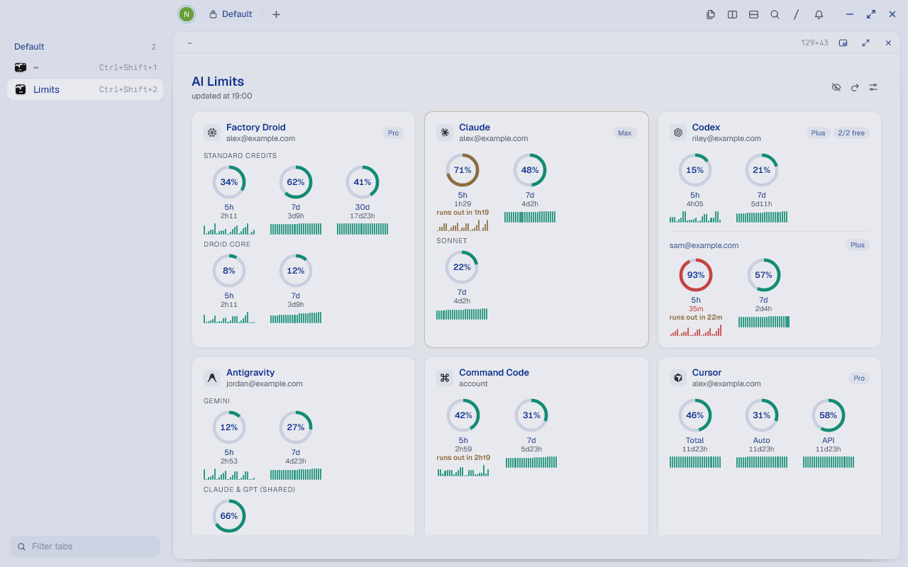
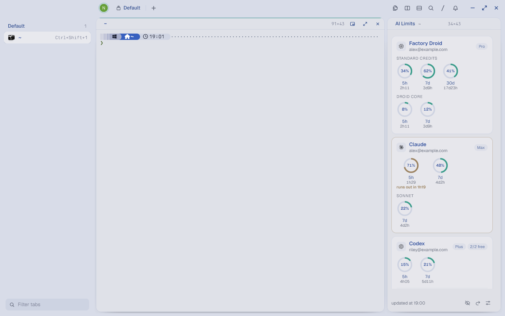
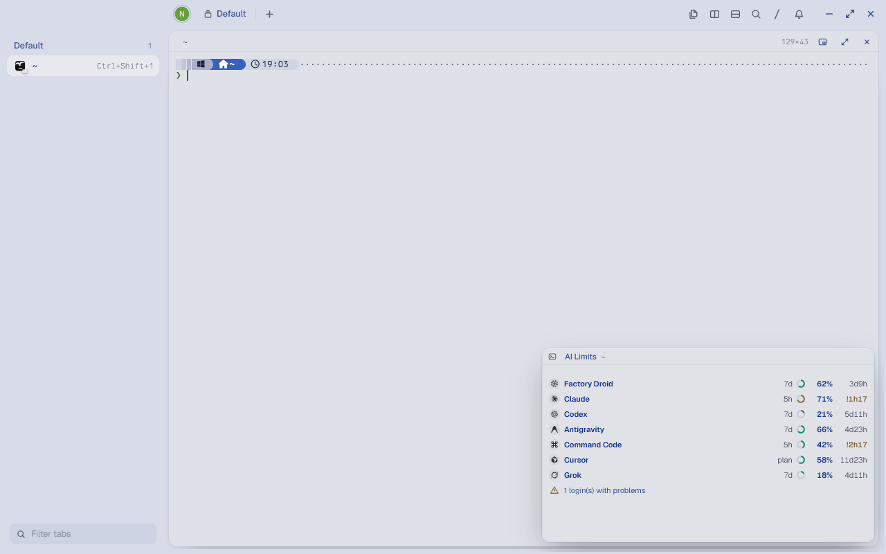
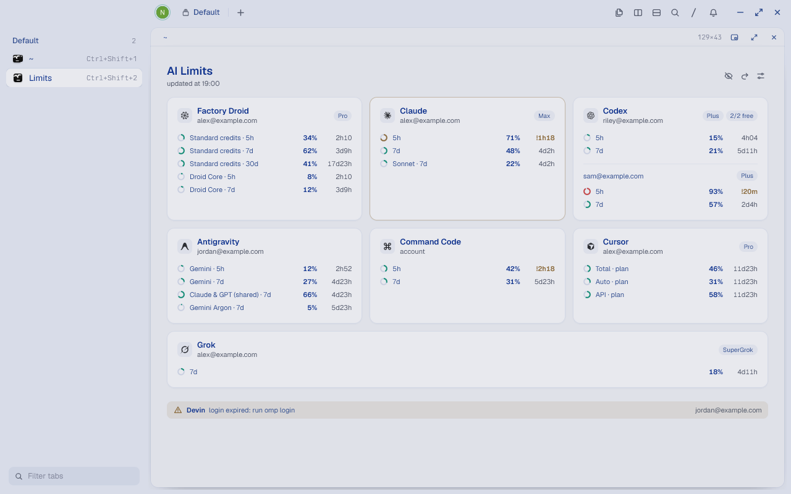
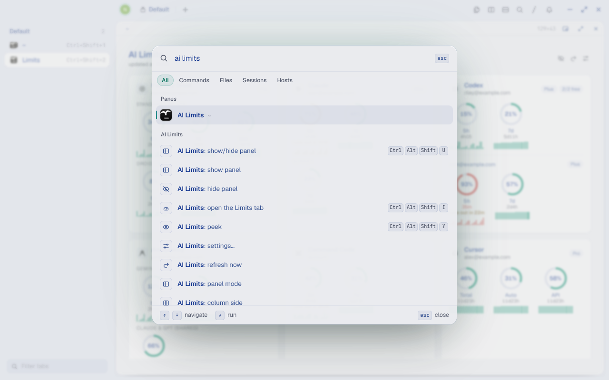

# AI Limits for Tern

A Tern plugin that shows how much of your AI coding plans you have left: every limit window (5-hour, weekly, monthly, plan period) as a ring, with the time until it resets. It lives in a side column, a drawer, a floating card, its own tab, the status bar and the window title, and it can warn you before a limit runs out.



The interface is in English, with Brazilian Portuguese as an option (**AI Limits: language**).

## Providers

| Provider | Where the usage comes from |
| --- | --- |
| Claude (Claude Code) | your `claude` login, or omp |
| Codex (ChatGPT plan) | your `codex` login, or omp |
| Cursor | the Cursor app or `cursor-agent login` |
| Grok | `grok login` |
| Factory (Droid) | an API key you save in the plugin, or omp |
| OpenCode Go | an API key you save in the plugin, or omp |
| Command Code | an API key you save in the plugin |
| Antigravity, Devin, Gemini CLI, Kimi, z.ai, MiniMax, Copilot | omp (`omp login <provider>`) |

omp is optional. Without it, the plugin reads each tool's own login directly. The plugin only reads those logins: it never refreshes or rewrites another tool's credentials, and each token only goes to its own provider's API.

## Requirements

- Tern 0.9 or later.
- Windows, with Windows PowerShell 5.1 (it ships with Windows 10 and 11). The direct readers are PowerShell scripts. On macOS and Linux only the omp source works.
- Optional: omp, logged in to the providers you want.

## Install

```sh
tern plugin install github.com/pfTheTrial/tern-ai-limits
```

Tern reloads its plugins and the **AI Limits** column opens at the right edge of the active tab.

To work on a local copy instead, clone the repository and link it:

```sh
git clone https://github.com/pfTheTrial/tern-ai-limits
tern plugin link tern-ai-limits
```

Check that it loaded with `tern plugin list`. It should report `ai-limits ... ready`.

## Connect your accounts

Log in with the tools you use, then wait for the next refresh or press `r` in the panel:

- **Claude Code:** run `claude` and use `/login`.
- **Codex:** run `codex` and log in. An expired login shows as *Codex login expired*; open the CLI once and it renews itself.
- **Cursor:** sign in to the Cursor app, or run `cursor-agent login`.
- **Grok:** run `grok login`.
- **Factory, OpenCode Go, Command Code:** open the command palette, run **AI Limits: API keys**, pick the provider and paste the key. Leave the field empty to delete a saved key. Keys are kept in the Windows Credential Manager through Tern's secret store. The key is visible while you type it. Environment variables also work: `FACTORY_API_KEY`, `OPENCODE_API_KEY`, `COMMANDCODE_API_KEY`.
- **Everything else:** `omp login <provider>`.

To stop using omp even when it is installed, run **AI Limits: where limits come from** and choose *Direct reading only, no omp*.

## Use it

Every action is in Tern's command palette: press `Ctrl+Shift+P` and type **ai limits** (or **limites de ia** when the interface is in Portuguese) to list them all.

| Shortcut | Does |
| --- | --- |
| `Ctrl+Alt+Shift+U` | Show or hide the panel |
| `Ctrl+Alt+Shift+I` | Open the **Limits** tab, with every account and the last day of usage |
| `Ctrl+Alt+Shift+Y` | Peek: every account in the palette |

Inside the panel: `r` refreshes, `e` hides or shows e-mails, `c` opens the settings.

- **Panel modes:** a fixed column (default), a drawer that opens on the shortcut, a floating card, or off. The pane header's picture-in-picture button switches to the floating card, and its dock button switches back.
- **Hiding:** hiding the panel parks it as a chip at the bottom of the window. Click the chip to bring it back.
- **Floating card:** at rest it shows one line per provider, or a single provider. Click it to focus it: Tern enlarges it and it shows everything.
- **Several accounts of one provider:** click an account's row to put it in front. The pin icon in the card header goes back to the most available account.

## Screenshots

| Side column | Floating card |
| --- | --- |
|  |  |
| **Compact list** | **Command palette** |
|  |  |

The screenshots use demo accounts and made-up numbers.

## Settings

Everything is in the palette under **AI Limits: settings…** (or the sliders icon at the bottom of the panel):

- **Language**: English or Português (Brasil). Switching reloads the plugin.
- **Panel mode**: column, drawer, floating card or off.
- **Providers, windows, accounts, order**: hide providers, limit windows or accounts, and choose the order.
- **Card density**: rings, or a compact list. Narrow columns use the list automatically.
- **Status bar**: every provider, only those past 70%, or the first three.
- **Refresh interval**: every 1 to 30 minutes (default 5).
- **Limit alerts**: toasts at 50/70/80/90%, when a limit runs out, when it resets, when the recent pace will exhaust it before the reset, and when a login breaks.
- **Floating card content**, **column side** and **width**, **floating card corner**.
- **Where limits come from** and **API keys**, described above.

## History and pace

The plugin keeps one reading per limit window per hour, for a week, in `history.json` in its data folder. The **Limits** tab draws the last 24 hours as a sparkline. When the pace of the last few hours would use a limit up before it resets, the card says *runs out in 3h*, and a toast tells you once.

## Uninstall

```sh
tern plugin remove ai-limits
```

Saved API keys stay in the Windows Credential Manager under `so.stencil.tern/plugin.ai-limits.*`. Delete them from there, or with **AI Limits: API keys** before removing the plugin.

## Notes

- Cursor's and Grok's usage endpoints are the ones their own apps call. They are not documented public APIs and may change without notice.
- Tern tilts floating cards at rest, and the tilt blurs their text. The plugin's stylesheet turns the tilt off for every floating card, not only its own.

## Credits

The provider icons are monochrome versions of [CodexBar](https://github.com/steipete/CodexBar)'s provider icons (MIT, © Peter Steinberger), and its documentation was the reference for most of the direct readers.
